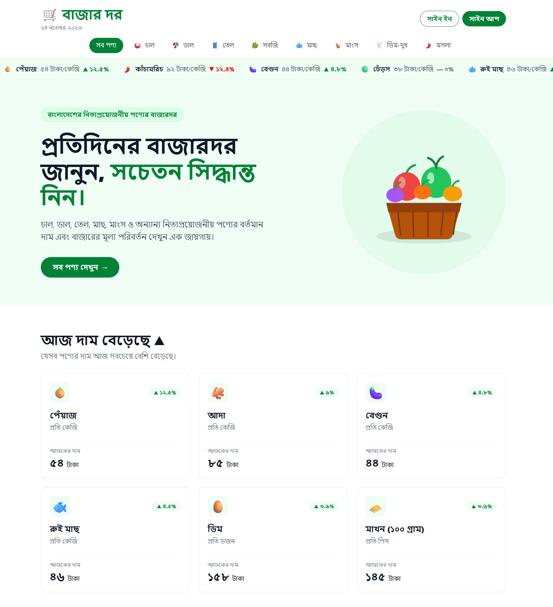

# BazarDor

A price comparison platform for essential commodities in Bangladesh. BazarDor helps users explore product prices, compare market-level price ranges, browse categories, and view current price trends through a responsive Next.js application.



**Live Preview:** [BazarDor](https://yourbazar-dor.vercel.app)

## Features

- **Home Page:** Browse essential commodities, including today's top six price risers, top six price fallers, and the complete product listing.
- **Live Price Ticker:** View a continuously animated ticker featuring product price information.
- **Dynamic Categories:** Explore products by category using category data loaded from the BazarDor API.
- **Product Sorting:** Sort category products by current price, from low to high or high to low.
- **Product Details:** View product information, price summaries, and market-level price ranges.
- **Market Comparison:** Compare minimum and maximum prices across 12 markets, with division information.
- **Price Summary:** See minimum and maximum market prices and an estimated average calculated from the available market price ranges.
- **Email Authentication:** Create an account and sign in using email and password.
- **Social Authentication:** Sign in with Google or GitHub.
- **Protected Routes:** Restrict access to product details and profile pages to authenticated users.
- **Profile Management:** View account information and update the profile name.
- **Loading & Not Found States:** Provide loading skeletons and custom not-found pages for relevant routes.
- **Responsive Design:** Support desktop, tablet, and mobile screen sizes.
- **Bangla Formatting:** Format prices and product units for the application's Bengali-language interface.

## Tech Stack

- **Framework:** Next.js (App Router)
- **Frontend:** React, TypeScript
- **Styling:** Tailwind CSS
- **Authentication:** Better Auth
- **Database:** MongoDB (authentication data)
- **Data Source:** BazarDor REST API
- **Deployment:** Vercel
- **Development Tools:** Node.js, npm, Git, GitHub

## Getting Started

### Prerequisites

- Node.js (LTS version recommended)
- npm
- A MongoDB database
- Google and/or GitHub OAuth credentials for enabling social sign-in

### Installation

Clone the repository and navigate to the project directory:

```bash
git clone https://github.com/sasamir/bazardor.git
cd bazardor
```

Install dependencies:

```bash
npm install
```

### Environment Variables

Create a `.env.local` file in the project root and configure the following variables:

```env
DATABASE_URL="your_mongodb_connection_string"
BETTER_AUTH_SECRET="your_better_auth_secret"
BETTER_AUTH_URL="http://localhost:3000"
GOOGLE_CLIENT_ID="your_google_client_id"
GOOGLE_CLIENT_SECRET="your_google_client_secret"
GITHUB_CLIENT_ID="your_github_client_id"
GITHUB_CLIENT_SECRET="your_github_client_secret"
```

**Environment variable notes:**

- `DATABASE_URL` connects Better Auth to your MongoDB database.
- `BETTER_AUTH_SECRET` is the secret used by Better Auth. Use a strong, private value.
- `BETTER_AUTH_URL` should match the URL where the application is running. Use `http://localhost:3000` locally and your production domain in Vercel.
- Google and GitHub credentials are required only for the corresponding social sign-in providers.

Configure the OAuth applications with the appropriate callback URLs:

```text
Local Google callback:  http://localhost:3000/api/auth/callback/google
Local GitHub callback:  http://localhost:3000/api/auth/callback/github
```

For production, use the same callback paths with your deployed domain. Add all production environment variables in the Vercel project settings as well.

Keep `.env.local` private. Do not commit credentials or secrets to GitHub.

### Run Locally

Start the development server:

```bash
npm run dev
```

Open the application in your browser:

```text
http://localhost:3000
```

### Production Build

Create a production build:

```bash
npm run build
```

Start the production server locally:

```bash
npm start
```

## Project Structure

The following is a high-level overview of the main application directories and files:

```text
bazar-dor/
├── app/
│   ├── category/
│   │   └── [slug]/
│   │       ├── loading.tsx
│   │       ├── not-found.tsx
│   │       └── page.tsx
│   ├── product/
│   │   └── [slug]/
│   │       ├── loading.tsx
│   │       ├── not-found.tsx
│   │       └── page.tsx
│   ├── profile/
│   │   ├── update/
│   │   │   └── page.tsx
│   │   └── page.tsx
│   ├── signin/
│   ├── signup/
│   ├── layout.tsx
│   └── page.tsx
│
├── components/
│   ├── category/
│   │   └── category-products.tsx
│   ├── home/
│   │   ├── all-products-section.tsx
│   │   ├── hero-section.tsx
│   │   ├── home-products-skeleton.tsx
│   │   ├── price-change-section.tsx
│   │   └── product-card.tsx
│   ├── layout/
│   │   ├── footer.tsx
│   │   ├── navbar-client.tsx
│   │   ├── navbar.tsx
│   │   ├── price-ticker.tsx
│   │   └── site-chrome-visibility.tsx
│   ├── product/
│   │   ├── market-price-table.tsx
│   │   ├── price-summary.tsx
│   │   └── product-details-summary.tsx
│   └── profile/
│       └── update-profile-form.tsx
│
├── lib/
│   ├── api.ts
│   ├── auth-client.ts
│   ├── format.ts
│   └── session.ts
│
├── public/
├── package.json
└── README.md
```

## Data & Routing

### Product and Category Data

Product and category information is loaded from the BazarDor REST API. The application does not use MongoDB to store the commodity price catalogue; MongoDB is used by Better Auth for authentication-related data.

The product data used by the application includes fields such as:

- Product ID, slug, name, category, and category icon
- Unit and product image
- Current, previous-day, previous-week, and previous-month prices
- Price direction and percentage change
- Market name, division, and minimum/maximum price range

Category data includes the category slug, Bengali name, and icon. The API currently provides product price information for 12 markets.

### Application Routes

| Route              | Description                                                                |
| ------------------ | -------------------------------------------------------------------------- |
| `/`                | Home page with price trends and the product catalogue                      |
| `/category/[slug]` | Products belonging to a selected category, with price sorting              |
| `/product/[slug]`  | Product details and market-level price comparison; requires authentication |
| `/signin`          | Sign-in page                                                               |
| `/signup`          | Registration page                                                          |
| `/profile`         | Authenticated user's profile page                                          |
| `/profile/update`  | Update the authenticated user's profile name                               |

### Authentication

Authentication is handled by Better Auth and uses MongoDB for authentication data.

- Users can register and sign in with email and password.
- Google and GitHub OAuth are supported.
- Protected pages require an authenticated session.
- After authentication, users can access their profile and update their profile name.

### Price Summary Calculation

The product API provides minimum and maximum prices for each market. The product details page displays the lowest available market minimum and the highest available market maximum. The displayed average is an **estimate** calculated from the midpoints of the available market price ranges; it is not a separate average value supplied by the API.

## API Integration

The application consumes the BazarDor REST API at:

```text
https://openapi.programming-hero.com/api/bazardor
```

The API integration is organized in `lib/api.ts`. The application uses the API to retrieve product lists, categories, products by category, and individual product details.

| Method | Endpoint                    | Purpose                                     |
| ------ | --------------------------- | ------------------------------------------- |
| `GET`  | `/products`                 | Retrieve the product catalogue              |
| `GET`  | `/categories`               | Retrieve available categories               |
| `GET`  | `/categories/{slug}`        | Retrieve a category by slug                 |
| `GET`  | `/products?category={slug}` | Retrieve products in a category             |
| `GET`  | `/products/{id}`            | Retrieve detailed information for a product |

These are external API endpoints consumed by the application. Product catalogue and market price data are not stored in the application's MongoDB database.

## Testing

Run ESLint to check code quality:

```bash
npm run lint
```

Create a production build:

```bash
npm run build
```

Preview the production build locally:

```bash
npm start
```

The deployed application should also be tested for authentication, OAuth sign-in, protected routes, session persistence, category sorting, product details, profile updates, and responsive layouts.

## Author

**Sabbir Ahmed Samir**

- GitHub: [@your-username](https://github.com/sasamir10)
- LinkedIn: [Your LinkedIn Profile](https://www.linkedin.com/in/sabbirahmed10)
